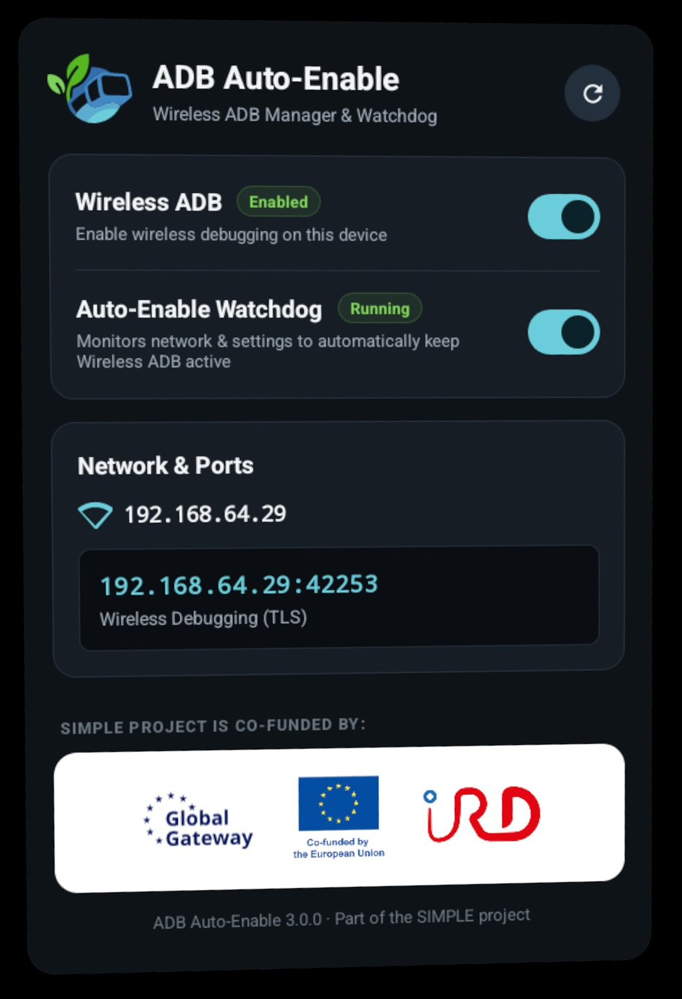

# adb-auto-enable

Automatically keeps wireless ADB debugging enabled on Meta Quest devices — no root required.

> **Security notice:** Wireless ADB provides full shell access to the device. Only use this on isolated, trusted networks. Never expose port 5555 to the internet or untrusted networks.



## How it works

- **On boot:** `BootReceiver` catches `BOOT_COMPLETED` and starts the watchdog service.
- **Settings observer:** Watches the `adb_wifi_enabled` global setting. Any change to `0` is immediately reversed.
- **Network callback:** Re-enforces ADB on every WiFi connection and validation event (covers network changes and reconnects).
- **Periodic watchdog:** Fallback check every 60 seconds in case the above hooks are missed.
- **Debounce:** A 500 ms guard prevents rapid-fire re-triggering.
- **VrUsb popup (Meta Quest):** The accessibility service detects the "VrUsb" trust dialog by window title and clicks its "Always allow on this network" button (`android:id/button3`) through an accessibility node action, fully automatically. It listens to window events only and does not intercept input.

## Requirements

- Meta Quest on Android 11 (API 30) or later (tested on Meta Quest 3, and on several firmware versions)
- `WRITE_SECURE_SETTINGS` permission granted once via ADB from a PC (see Setup)
  - `adb shell pm grant eu.project_simple.adbautoenable android.permission.WRITE_SECURE_SETTINGS`
- Accessibility service enabled on the headset
  - The application self-configure it once the `WRITE_SECURE_SETTINGS` permission is granted

## Setup

### 1. Install the application

Download a pre-built APK from [Releases](https://github.com/project-SIMPLE/adb-auto-enable/releases). 

<details>
<summary>(advanced) Building the application</summary>

Building requires JDK 17 or 21 (Gradle 8.13 does not run on newer JDKs). If your default JDK is newer, point Gradle to a supported one in `~/.gradle/gradle.properties` with `org.gradle.java.home=/path/to/jdk-21`.

```bash
git clone https://github.com/project-SIMPLE/adb-auto-enable.git
cd adb-auto-enable
./gradlew assembleDebug
adb install app/build/outputs/apk/debug/app-debug.apk
```

Release builds (`./gradlew assembleRelease`) are signed and need `KEYSTORE_FILE`, `KEYSTORE_PASSWORD`, `KEY_ALIAS` and `KEY_PASSWORD` set in the environment.

</details>

### 2. Grant WRITE_SECURE_SETTINGS (Required)

This permission enables the app to turn on wireless debugging and auto-configure accessibility settings. Connect your device via USB to a PC and run:

```bash
adb shell pm grant eu.project_simple.adbautoenable android.permission.WRITE_SECURE_SETTINGS
```

### 3. Accessibility Service Configuration

The accessibility service automatically detects and clicks the Meta Quest "VrUsb" wireless-ADB trust dialog on boot.

> [!NOTE]
> **MetaOS / Horizon OS Behavior:** Meta replaces the standard Android Settings app with a VR panel (`com.oculus.panelapp.settings`) that hides third-party accessibility services.
>
> - **Automatic Setup (Recommended):** Once `WRITE_SECURE_SETTINGS` is granted (Step 2), opening ADB Auto-Enable automatically configures and enables the accessibility service.
>
> - **Manual Setup via ADB:** Run the following command from your PC:
>
>   ```bash
>   adb shell "settings put secure enabled_accessibility_services eu.project_simple.adbautoenable/eu.project_simple.adbautoenable.AdbPopupAccessibilityService && settings put secure accessibility_enabled 1"
>   ```
>
> - **Open Standard Android Accessibility UI:** To launch the native AOSP 2D settings window on Quest:
>
>   ```bash
>   adb shell am start -a android.settings.ACCESSIBILITY_SETTINGS -p com.android.settings
>   ```

### 4. Launch the app

Open **ADB Auto-Enable** from the app launcher. The GUI displays:

- **Watchdog status & toggle:** View if the background watchdog service is running, with an on/off toggle.
- **ADB Wireless status & toggle:** Manually enable or disable wireless ADB debugging.
- **Network & active ports:** Displays your device's Wi-Fi IP and all active ADB ports (dynamic TLS mDNS port, standard TCP/IP port 5555).
- **Health & permission checks:** Clear indicators and direct setup actions for `WRITE_SECURE_SETTINGS` and the Accessibility service.

## Troubleshooting

**Check permission status:**

```bash
adb shell dumpsys package eu.project_simple.adbautoenable | grep WRITE_SECURE_SETTINGS
```

Expected output: `android.permission.WRITE_SECURE_SETTINGS: granted=true`

**Check accessibility service state:**

```bash
adb shell settings get secure enabled_accessibility_services
adb shell settings get secure accessibility_enabled
```

Expected output:

- `enabled_accessibility_services`: contains `eu.project_simple.adbautoenable/eu.project_simple.adbautoenable.AdbPopupAccessibilityService`
- `accessibility_enabled`: `1`

**Check wireless ADB state:**

```bash
adb shell settings get global adb_wifi_enabled
```

Expected: `1`

**Connect wirelessly:**

```bash
# Standard port 5555
adb connect <DEVICE_IP>:5555

# Or TLS pairing port (Android 11+ dynamic port shown in the app)
adb connect <DEVICE_IP>:<TLS_PORT>
```

**Force-restart the app & service:**

```bash
adb shell am force-stop eu.project_simple.adbautoenable
adb shell am start -n eu.project_simple.adbautoenable/.MainActivity
```

**View live logs:**

```bash
adb logcat -s ADBAutoEnable ADBAutoEnable.A11y ADBAutoEnable.Discovery MainActivity
```

**Reset permissions if stuck:**

```bash
adb shell cmd appops reset eu.project_simple.adbautoenable
adb shell pm grant eu.project_simple.adbautoenable android.permission.WRITE_SECURE_SETTINGS
```

---

Technical blog post : https://arthurbrugiere.fr/blog/2026/05/mq3-wireless-adb/
